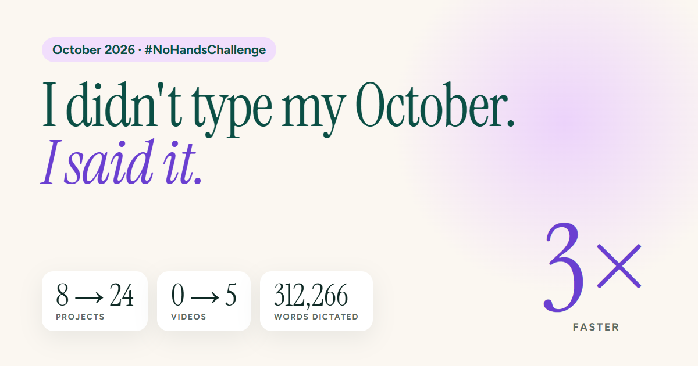

# I didn't type my October. I said it.

**The JARS DEMO October, 2026, shipped by voice.** Live at [hacktober2026.jishanahmed.in](https://hacktober2026.jishanahmed.in).



I was already shipping in October, because October is Hacktober. Then on 16 October [Wispr Flow](https://wisprflow.ai) came in for the WeMakeDevs No Hands challenge, and I got about 3x faster. Every spec, every prompt to my coding agent, every correction and every video script after that was dictated, not typed.

| | 30 Sep – 15 Oct (typing) | 16 – 31 Oct (talking) |
| --- | ---: | ---: |
| Projects | 8 | 24 |
| Videos | 0 | 5 |
| Projects a day | 0.5 | 1.5 |

## What is on the page

- **Same month, two speeds.** The 16 days before Wispr Flow next to the 16 days after it.
- **Projects shipped, day by day.** One bar per day with a marker at 16 October. Tap a bar to see what shipped.
- **The headliners.** [Breakdown](https://wispr.jishanahmed.in), my No Hands challenge entry, and the [$6 billion Binance heist explainer](https://youtu.be/fztHxrgbt3Q).
- **Videos this October.** Each loads as a thumbnail and only starts the YouTube player when tapped.
- **How I build now.** The eleven steps from spec sheet to published video, and where Wispr Flow comes in.
- **Every project.** Filter by topic or search; each card links to the live site, the code and the video.
- **My Wispr Flow usage card.**
- **Play my October.** A full-screen replay of the month, about 45 seconds, with music and sound effects.

## The sound

Short audio files made with ElevenLabs: a looping music bed and five effects, about 380 KB in total. They are decoded once and played as buffers, so they play smoothly on phones too; nothing is synthesised in the browser. Sound is off until you turn it on or press Play, and pauses when the tab is hidden.

## Updating the Wispr Flow numbers

Edit `public/assets/flow.js` (words, words per minute, apps, streak, date) and replace `public/assets/flow-card.png` with the new usage card. Everything on the page reads from there.

## Run it locally

A static site with no build step and no dependencies:

```bash
npm start                         # or: python -m http.server -d public 8000
npm test                          # Node's built-in test runner, Node 20 or later
```

The page uses ES modules, so open it through a server, not as a file.

## Layout

```text
public/index.html          the page
public/og.png              the 1200 x 630 share image
public/assets/data.js      the 32 repositories (GitHub API, 31 October 2026), topics and videos
public/assets/flow.js      my Wispr Flow usage numbers
public/assets/model.js     days, the before and after split and the filter: pure functions, tested
public/assets/sound.js     the recorded sound
public/assets/app.js       the page and the played month
public/assets/audio/       the music bed and sound effects
tests/model.test.mjs       data and model checks
vercel.json                static hosting, clean URLs and security headers
```

Wispr Flow, YouTube and GitHub are trademarks of their owners. This page is not affiliated with or endorsed by them.

## License

[MIT](LICENSE)
